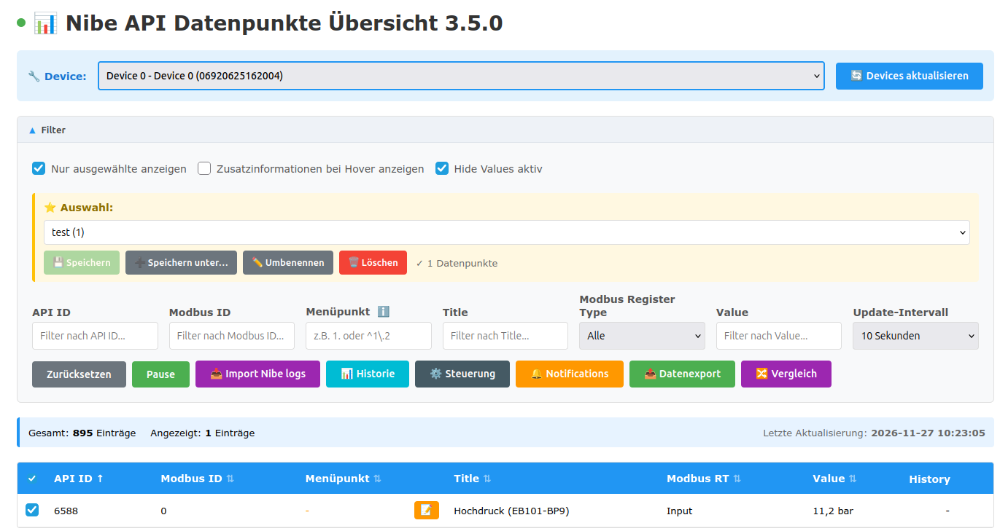
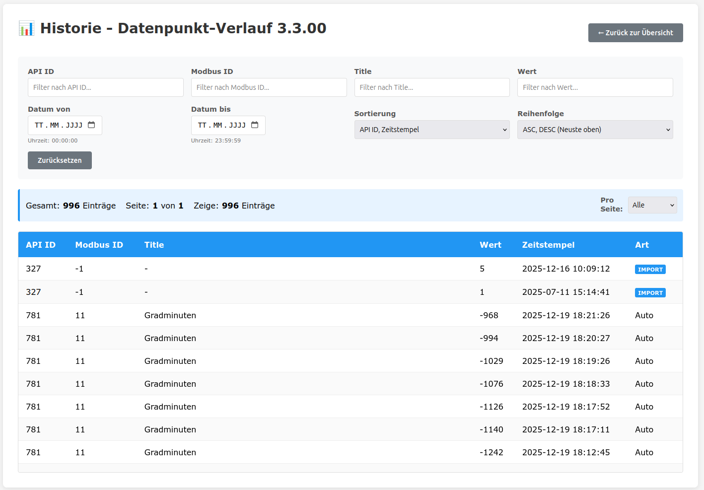
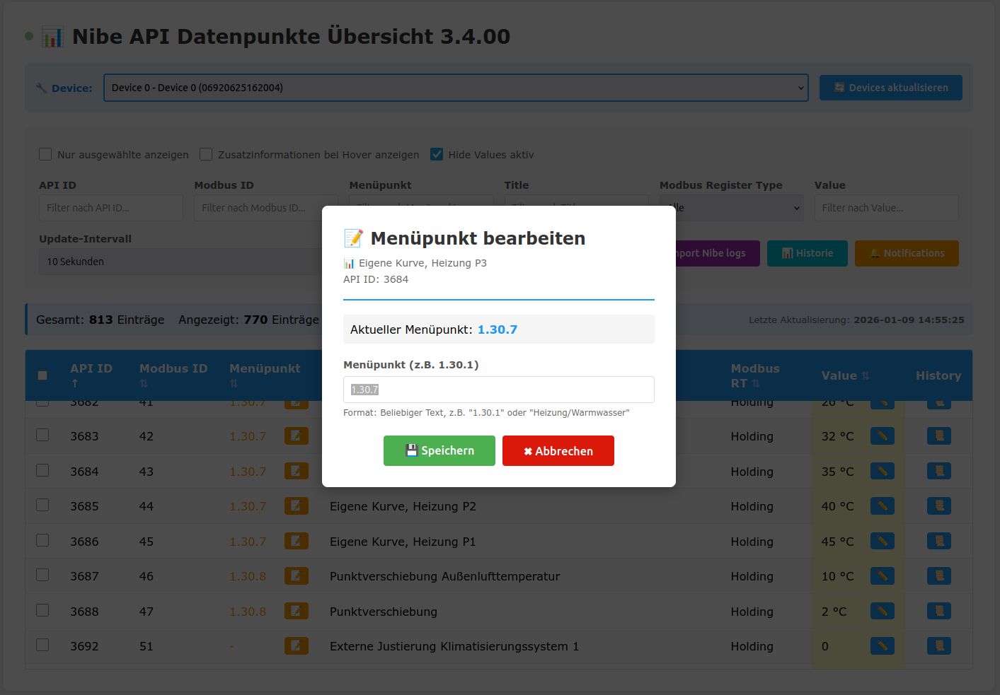
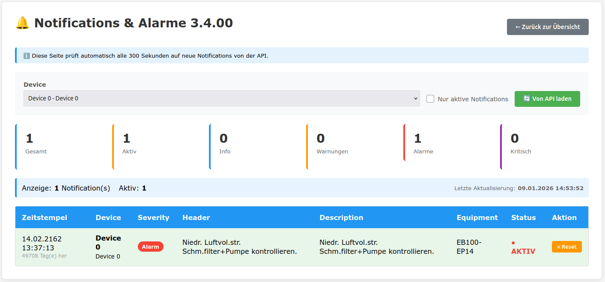
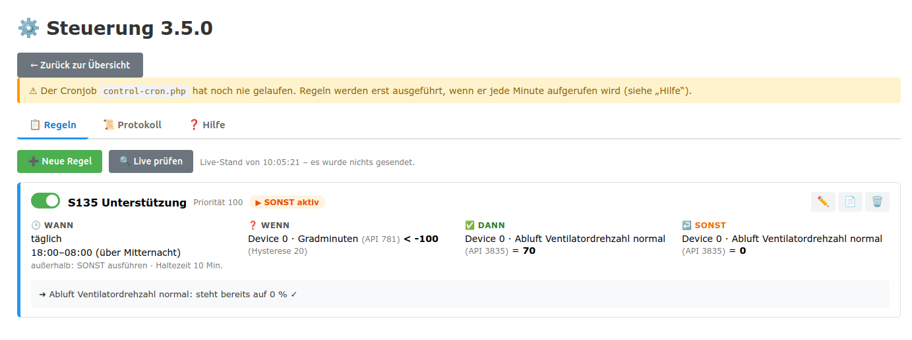

# NibeAPI 
Nibe REST API für Nibe S Geräte

Anzeige der Datenpunkte über die REST API.
Wenn das Schreiben erlaubt ist, können die Daten auch geändert werden. 
Das Ändern wird immer, angeboten, egal, ob das Ändern in der Steuerung erlaubt wurde oder nicht.

## Einrichten der lokalen REST API 
Ihr stellt euch vor eure WP und klickt euch zu Menüpunkt 7.5.15

* Schieberegler oben auf anstellen
* Benutzername: den braucht Ihr dann für die Anmeldung am REST-Server
* Passwort: siehe Benutzername
* IP-Adressenbeschränkung: Vielleicht dem ein oder andern schon von den Modbus TCP Settings bekannt, es kann durchaus sinnvoll sein, hier den Zugriff auf die IP einzuschränken, von der Ihr dann auch auf REST zugreift
* Vertrauensw. IP: Die IP-Adresse des Gerätes, von dem Ihr auf die REST API zugreifen wollt, falls ihr die Adressenbeschränkung aktiviert habt
* Nur Lesen von REST API: Sollte man für initiale Tests erstmal anschalten, falls man später bestimmte Werte auch schreiben will, muss man den Teil deaktivieren

Für die Ausführung wird ein Webserver mit PHP benötigt.
Kopiert die beiden Dateien config.php und index.php in ein Verzeichnis. 
Bei einem neuen Server direkt in das root Verzeichnis des Webservers.

In der config.php müssen 4 Parameter angepasst werden:

* API_IP        IP Adresse der Nibe Steuerung.
* API_PORT      Port der Nibe API in der Regel 8443.
* API_USERNAME  wird in der Nibesteuerung festgelegt
* API_PASSWORD  wird in der Nibesteuerung festgelegt

Wenn die Datenbank genutzt werden soll, müssen noch die Anpassungen für die Maria oder MySQL Datenbank gemacht werden. 
Die Datenbankstruktur findet ihr in der Datei init_db_nibeapi.sql

Um die Übersichtlichkeit zu erhöhen, liegen nun alle Dateien im Ordner nibeapi.

### Version 3 ist eine Datenbankfunktion dazu gekommen.
In die Datenbank werden alle schrei baren Datenpunkte geschrieben. 
Wenn sich ein Wert ändert, wird diese mit Zeitstempel in die Logtabelle geschrieben.
Wird ein Wert mit NibeApi geändert, ist dieser Wert mit markiert.
So kann unterschieden werden ein Wert mit der Anwendung oder an der Steuerung bzw. mit der App geändert wurde.
Nibe ändert schreibbare Werte auch selbst. Bei mir sind es 2 Werte mit Gradminuten. Diese können mit dem Parameter NO_DB_UPDATE_APIID ausgeschlossen werden, damit das Log nicht unnötig voll läuft.
Die API wird alle 10 Sekunden gelesen. Das Update Intervall ist in der config.php einstellbar.

### Version 3.2.00
- ✨ PHP Datei wurde in mehrere Dateien aufgeteilt, damit die Wartbarkeit verbessert wird.
- ✨ Edit-Modal für Wertänderungen
- ✨ History mit Undo-Funktion
- ✨ Import-Funktion
- ✨ Dynamisches Update-Intervall
- ✨ Persistente Sortierung
- 🐛 Diverse Bugfixes

### Version 3.4.00
- ✨ Komplette RestApi implementiert. Mehrere Geräte werden nun berücksichtigt.
- ✨ Historie Seite mit Filter und Sortiermöglichkeiten.
- ✨ Alarme Seite mit Möglichkeit die Fehler zu löschen. (Die Funktion wurde wie in der Api vorgegeben implementiert, funktioniert aber nicht. Bei Nibe habe ich deshalb ein Ticket eröffnet, welches aber mit Verweis auf den Händler, der sich um die Einstellungen kümmern soll, verwiesen wurde. Leider nicht das erste Mal, dass der Support das Ticket sofort schließt.)
- ✨ Neu Möglichkeit die Menüpunkte der einzelnen Datenpunkte in der Datenbank zu hinterlegen. Die Tabelle kann importiert und weiter gepflegt werden. Wer sich hier mit beteiligen möchte, ist herzlich eingeladen. Die Tabelle nibe_menuepunkte.sql werde ich immer mal erweitern. Evtl. kommt für einen besseren Austausch auch noch ein Im- / Export.
- ✨ Script, das als Cronjob eingebunden werden kann, das Änderungen in der Steuerung erfasst und bei Alarmen per E-Mail oder Telegram benachrichtigt.
- 🐛 Diverse Bugfixes
- ! Da es eine Änderung der Datenbankstruktur gegeben hat, müssen hier diverse Tabellen und Spalten eingerichtet werden. Schaut einmal in den UpgradeGiude3.4.txt
  
### Version 3.5.00
- ✨ Datenpunkt Auswahl kann gespeichert werden.
- ✨ Steuerung Erstellung von komplexen Regeln um die Anlage zu steuern.
  
### Übersicht Seite

### Historie Seite

### pflegen von Menüpunkten

### Alarme

### Steuerung

